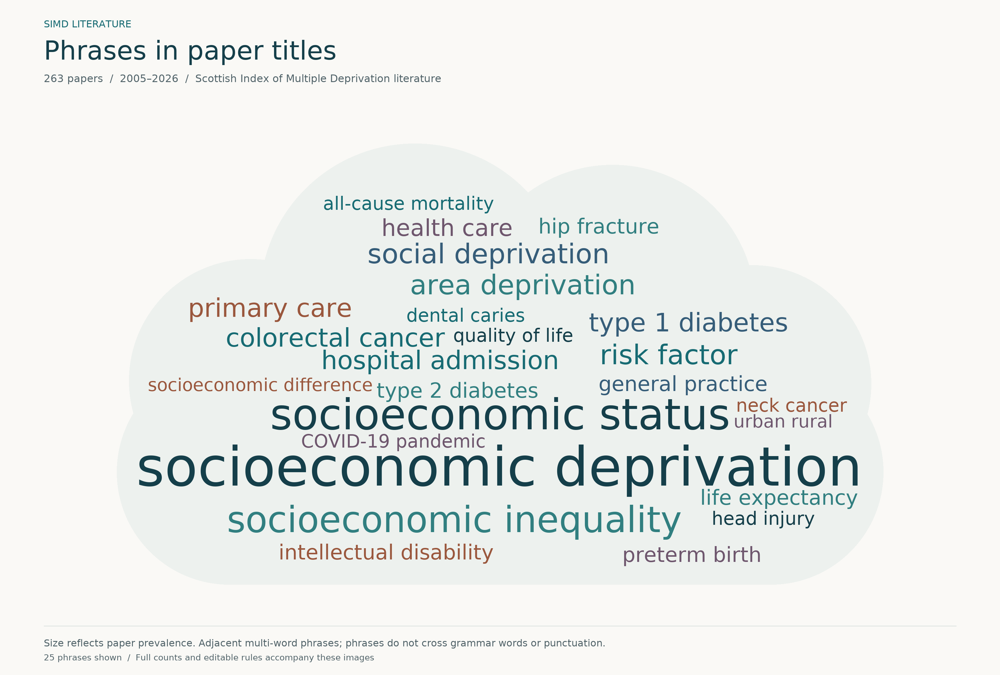

# SIMD literature word clouds

What do studies that use the **Scottish Index of Multiple Deprivation (SIMD)** write about? This repository turns the titles and abstracts of 263 indexed papers (2005–2026) into reproducible, reviewable word clouds.



The cloud counts **multi-word phrases**, so deprivation appears in the context it was studied: *socioeconomic*, *area* and *social* deprivation stay separate rather than collapsing into one word. Phrase size and shade both show how many papers use the phrase in their title. Each paper counts once, however often it repeats the phrase.

The [abstract cloud](wordclouds/outputs/abstracts_wordcloud.png) uses the same method on the full abstracts.

## Reading the cloud

- **Vocabulary, not findings.** The cloud shows what papers name in their titles. It does not show effect sizes, study quality or the direction of any association.
- **Phrases only.** A phrase is 2–3 adjacent words within a sentence. Grammar words, statistical and study-design wording, geography, deprivation-index names and data sources end a phrase, so "mortality and deprivation" or "most deprived SIMD quintile" never become phrases.
- **Ties are never split.** The title cloud shows the 25 phrases found in 3 or more titles. The 55 phrases found in exactly 2 titles are all left out together, so alphabetical order never decides which topics appear.
- **Accessible by design.** The font is [Atkinson Hyperlegible](https://www.brailleinstitute.org/freefont/), which gives easily confused characters (I/l/1, b/d, O/0) distinct shapes. The colours are three shades of a single blue, so they read the same with any colour vision deficiency, and each has at least 4.7:1 contrast with its background.

Every choice can be reviewed and edited in plain CSV and JSON files. [wordclouds/README.md](wordclouds/README.md) documents the full method.

## Reproduce

Requires Python 3.12. From the repository root:

```sh
python3.12 -m venv .venv-wordcloud
.venv-wordcloud/bin/python -m pip install -r wordclouds/requirements.txt
.venv-wordcloud/bin/python wordclouds/generate.py           # writes wordclouds/outputs/
.venv-wordcloud/bin/python wordclouds/test_processing.py    # 19 processing checks
```

Runs are deterministic: two runs with different Python hash seeds produce byte-identical images and tables ([reproducibility_check.json](wordclouds/reproducibility_check.json)). Package versions are pinned, and the font is bundled.

To rebuild the corpus CSVs from the archived metadata, run `.venv-wordcloud/bin/python wordclouds/prepare_corpus.py`.

## Repository contents

| Path | Contents |
| --- | --- |
| [`simd_263_papers_year_pmid_abstract.csv`](simd_263_papers_year_pmid_abstract.csv) | The corpus: year, PMID, indexed title and abstract, PDF status and source link for each paper |
| [`simd_252_papers_year_pmid_abstract.csv`](simd_252_papers_year_pmid_abstract.csv) | The original paper list, kept unchanged. Its abstracts are title-based template sentences, so it is not used for counting |
| [`simd_missing_fulltext_abstracts.csv`](simd_missing_fulltext_abstracts.csv), [`simd_pmids_not_downloaded.txt`](simd_pmids_not_downloaded.txt) | The 11 papers without a PDF, which are included in the corpus |
| [`research/`](research/) | Europe PMC metadata snapshots (4 October 2026) that the corpus is built from |
| [`wordclouds/generate.py`](wordclouds/generate.py) | Counting and rendering |
| [`wordclouds/term_groups.csv`](wordclouds/term_groups.csv), [`exclusions.csv`](wordclouds/exclusions.csv), [`settings.json`](wordclouds/settings.json) | Editable rules: phrases and spelling variants, excluded wording, thresholds, cloud shape, font and colours |
| [`wordclouds/outputs/`](wordclouds/outputs/) | PNG (300 dpi) and SVG clouds, exact frequencies, per-paper terms and a run manifest with input and output hashes |

To switch back to single-word clouds or a rectangular layout, change `phrases.enabled` or `shape.fields` in `settings.json` and rerun.

## Data and licences

- **Paper metadata:** titles and abstracts come from the [Europe PMC](https://europepmc.org/) records for each PMID. The abstracts remain the copyright of their publishers and authors, and are included here only so the analysis can be reproduced.
- **Font:** Atkinson Hyperlegible © Braille Institute of America, under the [SIL Open Font License 1.1](wordclouds/assets/AtkinsonHyperlegible-OFL.txt).
- **Rendering:** uses the MIT-licensed [wordcloud](https://github.com/amueller/word_cloud) package.
- **Code licence:** not yet chosen.
